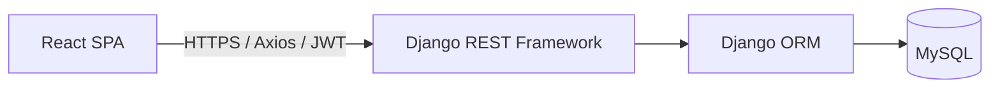

# DeskPilot — IT Helpdesk & Asset Management

DeskPilot is a role-based IT service desk and asset inventory application. Employees can raise and follow support tickets; IT support agents can triage and resolve permitted tickets; administrators manage users, reference data, and company IT assets.

## Technology stack

- **Frontend:** React 18, Vite, React Router, Axios, Bootstrap, Recharts
- **Backend:** Python, Django, Django REST Framework, Simple JWT
- **Database:** MySQL
- **API documentation:** drf-spectacular / Swagger UI
- **Production hosting plan:** Vercel (React), Render (Django API), Aiven (MySQL)

## Features

### Service desk

- JWT-based authentication and role-based authorization
- Ticket creation, listing, filtering, searching, ordering, and pagination
- Ticket assignment and controlled status transitions
- Public comments and internal support notes
- Ticket history and in-app notifications
- Role-specific dashboards

### IT asset management

- Asset inventory, categories, departments, and locations
- Asset assignment, reassignment, and return tracking
- Maintenance records and condition changes (damaged, lost, recovered, retired)
- Asset assignment history and append-only activity history
- Link assets to related support tickets

### Administration and security

- Administrator management of users, departments, and ticket/asset categories
- Deactivation instead of deleting reference records
- Backend-enforced permissions; frontend route guards are only a usability layer
- Public registration disabled by default
- Environment-based configuration for local and production deployments

> The application currently has no file-attachment workflow, email notifications, SLA/escalation engine, or frontend automated test suite. Notifications are in-app. Do not represent these capabilities as implemented.

## Architecture



### Backend layout

```text
backend/
├── config/                 # Django settings, root URLs, WSGI entry point
└── core/
    ├── migrations/         # Versioned schema changes
    ├── views/              # Authentication, tickets, assets, dashboards, directory, notifications
    ├── models.py           # Domain entities and relationships
    ├── serializers.py      # API input validation and response representations
    ├── permissions.py      # Shared role/permission helpers
    ├── workflow.py         # Ticket workflow rules and notification helpers
    ├── filters.py          # Query filters
    ├── pagination.py       # Standard API pagination
    ├── admin.py            # Django admin registrations
    └── tests.py            # Backend regression tests
```

### Frontend layout

```text
frontend/
├── src/
│   ├── api.js              # Axios client, JWT headers and token refresh
│   ├── context/            # Authentication state
│   ├── components/         # Shared layout, route guards and UI primitives
│   ├── pages/              # Dashboard, tickets, assets, users, settings, notifications
│   ├── App.jsx             # Client-side routes
│   └── styles.css          # Application styling
├── .env.example            # Local frontend API URL template
├── vercel.json             # SPA fallback for client-side routes
└── package.json
```

## Roles and access model

| Capability | Employee | IT Support Agent | Administrator |
|---|---|---|---|
| Create support tickets | Yes | Yes | Yes |
| View tickets | Own tickets | Permitted queue and assigned tickets | All tickets |
| Add internal notes | No | Yes, for visible tickets | Yes |
| Assign tickets | No | Limited to allowed workflow | Yes |
| Manage assets | View permitted assets | View assets and permitted history | Create, edit, assign, maintain and retire |
| Manage users and reference data | No | Read permitted reference data | Yes |
| View dashboard | Employee dashboard | Agent dashboard | Admin dashboard |

The backend is authoritative for permissions. Always verify access with API requests as well as the user interface before production use.

## Requirements

- Python 3.11 or newer (use a version supported by the pinned dependency ranges)
- Node.js 20 or newer and npm
- MySQL 8.x or a compatible MySQL service
- Git (recommended)

## Local setup on Windows

### 1. Configure the backend

Run these commands from the repository root in PowerShell or Command Prompt:

```bat
cd backend
python -m venv .venv
.venv\Scripts\activate
python -m pip install --upgrade pip
pip install -r requirements.txt
copy ..\.env.example ..\.env
```

Edit the root `.env` file with your local MySQL credentials. Create the `it_helpdesk` database in MySQL first, for example in MySQL Workbench:

```sql
CREATE DATABASE it_helpdesk CHARACTER SET utf8mb4 COLLATE utf8mb4_unicode_ci;
```

Then, still inside `backend/`, run:

```bat
python manage.py check
python manage.py migrate
python manage.py createsuperuser
python manage.py runserver
```

The superuser is treated as an administrator by the application. Log in to Django Admin at `http://127.0.0.1:8000/admin/` if you need to inspect records. No demo users or demo records are created automatically. After signing in to the application as an administrator, create departments, categories, and user accounts through the administration screens.

### 2. Configure the frontend

Open a second terminal from the repository root:

```bat
cd frontend
copy .env.example .env
npm ci
npm run dev
```

Open `http://localhost:5173`. The frontend API base URL defaults to `http://127.0.0.1:8000/api`; override it in `frontend/.env` with `VITE_API_BASE_URL` if needed. Restart the Vite server after changing environment variables.

### Useful local URLs

- React application: `http://localhost:5173/`
- API root: `http://127.0.0.1:8000/api/`
- Django Admin: `http://127.0.0.1:8000/admin/`
- Swagger UI: `http://127.0.0.1:8000/api/docs/`
- OpenAPI schema: `http://127.0.0.1:8000/api/schema/`

## Environment variables

### Django backend

| Variable | Required | Description |
|---|---|---|
| `SECRET_KEY` | Yes in production | Long, random Django secret; never commit the real value |
| `DEBUG` | Yes in production | Set to `False` in production |
| `ALLOWED_HOSTS` | Yes in production | Comma-separated API hostnames, without URL schemes |
| `CORS_ALLOWED_ORIGINS` | Yes | Comma-separated frontend origins, including scheme and no trailing slash |
| `CSRF_TRUSTED_ORIGINS` | For production | Comma-separated trusted HTTPS origins |
| `ALLOW_PUBLIC_REGISTRATION` | Optional | Defaults to `False`; only enable intentionally |
| `DB_NAME` | Yes | MySQL database name |
| `DB_USER` | Yes | MySQL username |
| `DB_PASSWORD` | Yes | MySQL password |
| `DB_HOST` | Yes | MySQL hostname |
| `DB_PORT` | Yes | MySQL port, commonly `3306` |
| `DB_SSL_CA` | Provider-dependent | Path to the CA certificate when managed MySQL requires configured TLS verification |

### React frontend

| Variable | Description |
|---|---|
| `VITE_API_BASE_URL` | Full API base URL ending in `/api`, e.g. `https://your-api.example.com/api` |

Only variables prefixed with `VITE_` are bundled into the browser application. Never place secrets in frontend environment variables.

## API overview

The API uses JWT bearer tokens. Sign in through `POST /api/auth/login/`, use the returned access token in the `Authorization: Bearer <token>` header, and refresh through `POST /api/auth/refresh/` when needed.

Main resource groups:

- `/api/auth/` — login, refresh, current user, optional registration endpoint (disabled by default)
- `/api/tickets/` — tickets, assignment, status changes, comments and history
- `/api/assets/` — inventory, assignments, maintenance, condition actions and activity history
- `/api/users/`, `/api/departments/`, `/api/ticket-categories/`, `/api/asset-categories/`
- `/api/notifications/`
- `/api/dashboard/admin/`, `/api/dashboard/agent/`, `/api/dashboard/employee/`

See Swagger UI at `/api/docs/` while the backend is running for the generated endpoint schema and request formats.

## Validation and manual workflow checks

Run backend checks from `backend/`:

```bat
python manage.py check
python manage.py migrate --check
python -m pytest
```

Build the frontend from `frontend/`:

```bat
npm ci
npm run build
```

Recommended manual checks before release:

1. Create an administrator with `createsuperuser`; create a department, ticket category, asset category, agent and employee.
2. As an employee, create a ticket and verify it appears in the employee ticket list.
3. As an agent, assign/take the ticket, add a public comment and an internal note, and follow permitted status transitions.
4. As the employee, verify the internal note is not visible and test the allowed close/reopen workflow.
5. As an administrator, create an asset, assign it to an active employee, return/reassign it, record maintenance, and review activity history.
6. Attempt restricted operations with a non-admin account and verify the API rejects them.
7. Refresh pages and restart the backend to confirm persisted records remain in MySQL.

The repository includes backend tests, but the test suite and production build must be run in the target environment before declaring the release verified.

## Deployment plan

The intended deployment topology is **Vercel (React) + Render (Django API) + Aiven (MySQL)**. The providers' free plans and limits can change; confirm current pricing, sleep behavior, storage limits and database availability before committing to a $0/month target.

### 1. Prepare the database (Aiven)

1. Create a MySQL service and database, then record the host, port, database name, username and password in a secure place.
2. Download the provider's CA certificate if TLS verification requires one. Configure `DB_SSL_CA` to a certificate path available to the running backend, and confirm the connection options required by the current Aiven service.
3. Back up any existing database before importing data or applying schema changes.

### 2. Deploy the Django API (Render)

Create a Python web service from the repository and set its root directory to `backend`.

- Build command: `pip install -r requirements.txt`
- Start command: `python manage.py migrate && python manage.py collectstatic --noinput && gunicorn config.wsgi:application`
- Set environment variables: `SECRET_KEY`, `DEBUG=False`, `ALLOWED_HOSTS=<your-render-host>`, `CORS_ALLOWED_ORIGINS=<your-vercel-origin>`, `CSRF_TRUSTED_ORIGINS=<your-https-origins>`, and the Aiven `DB_*` values.
- Set `DB_SSL_CA` only when the certificate file is present at the configured path. Validate the TLS setup before exposing the service.
- After deployment, verify `/api/docs/`, `/admin/`, login, migrations, and API connectivity. Create the initial administrator securely; do not ship a default account.

### 3. Deploy the React SPA (Vercel)

Import the repository into Vercel and configure:

- Root directory: `frontend`
- Framework preset: Vite (or equivalent Vite settings)
- Build command: `npm run build`
- Output directory: `dist`
- Environment variable: `VITE_API_BASE_URL=https://<your-render-host>/api`

`frontend/vercel.json` rewrites client-side routes to `index.html`. After deploying, confirm that direct navigation and page refreshes work on routes such as `/tickets` and `/assets`.

### 4. Production verification

- Confirm the frontend calls the production API rather than localhost.
- Verify CORS and CSRF settings using the actual deployed origins.
- Confirm `DEBUG=False`, HTTPS, a non-default secret, and restricted `ALLOWED_HOSTS`.
- Test login, token refresh, role permissions, ticket lifecycle, asset lifecycle, and persistence after backend restart.
- Review provider logs and error responses; do not expose credentials in logs or screenshots.
- Configure database backups and understand free-tier limits before relying on the deployment.

Cloudinary is not required by the current DeskPilot feature set because the application does not currently upload files. Add object/image storage only if a real upload feature is implemented.

## Security and data notes

- Never commit `.env`, database passwords, production secrets, user exports, or database dumps.
- The repository's `.env.example` files contain placeholders only.
- Use a unique production `SECRET_KEY` and strong account passwords.
- Keep `DEBUG=False` in production and configure exact host/origin allowlists.
- Back up the database before migrations or destructive maintenance.
- The asset activity history records changes made through the application API; direct SQL changes are not recorded by that application-level audit log.
## Django Admin: permanent asset cleanup

The Assets admin uses a confirmation-based, superuser-only action named **Permanently delete selected assets and their history**. It deletes associated `AssetHistory` rows only after explicit confirmation. The database relationships and normal append-only history permissions remain unchanged. If any selected asset has protected assignment or maintenance records, the action aborts the entire selection and reports the blockers; no assets are deleted in that attempt. Back up the database before using permanent deletion.

