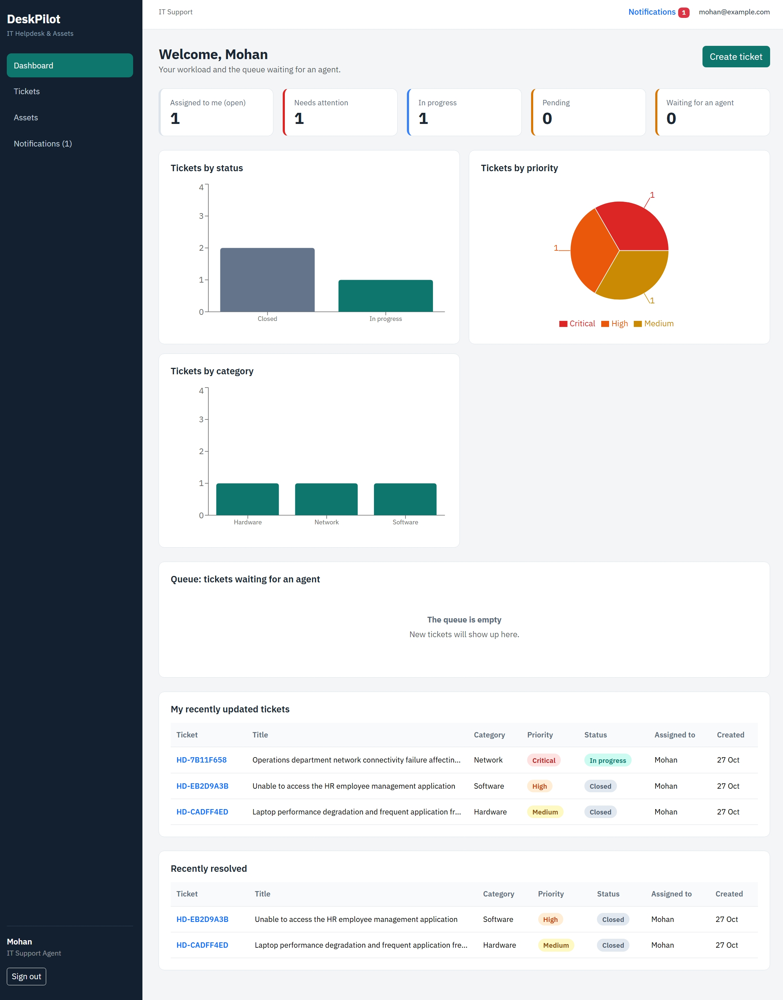
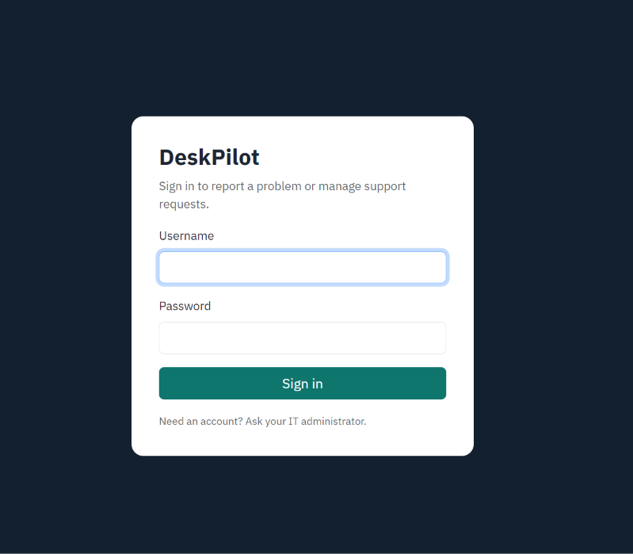
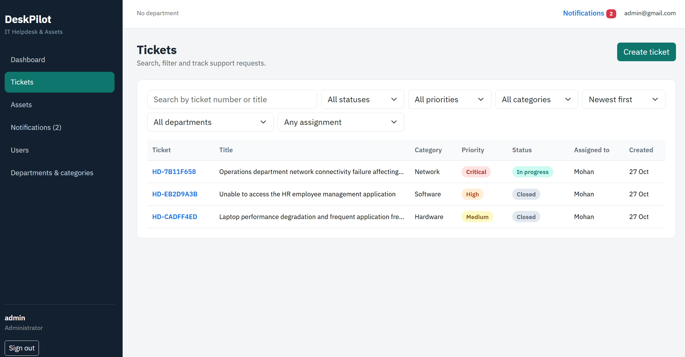
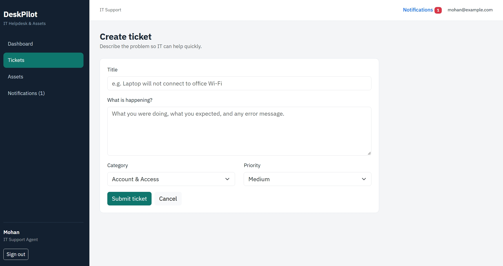
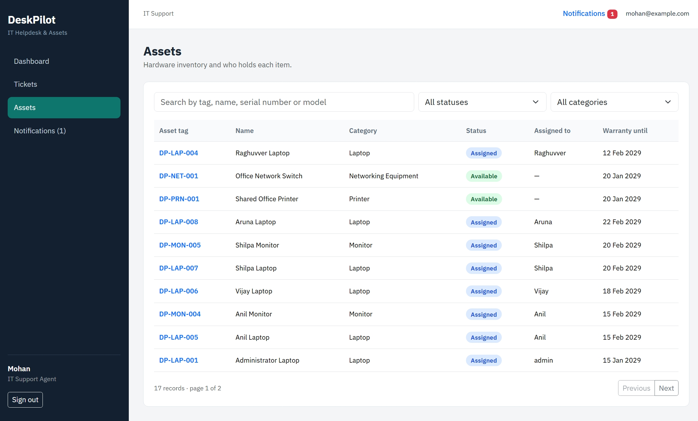
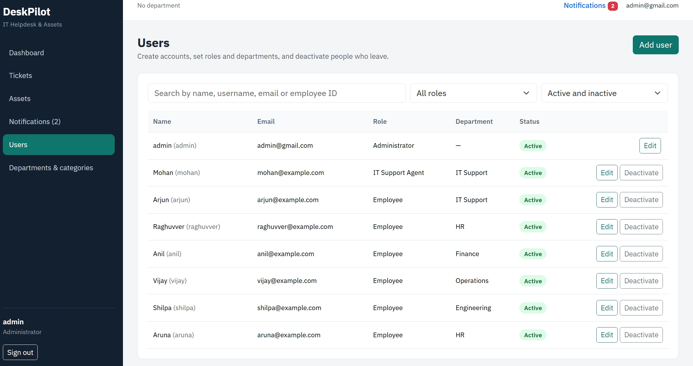
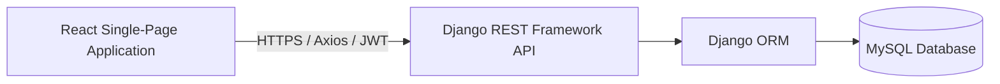

# DeskPilot — IT Helpdesk & Asset Management System

DeskPilot is a role-based IT service desk and asset inventory application built with **React, Django REST Framework, and MySQL**. Employees can raise and track support tickets, IT Support Agents can investigate and manage permitted tickets, and Administrators can manage users, reference data, and company IT assets.

<p align="left">
  <a href="https://desk-pilot-it-helpdesk.vercel.app/"><strong>Live Demo</strong></a> ·
  <a href="https://deskpilot-backend-jgn0.onrender.com/api/docs/"><strong>API Documentation (Swagger)</strong></a> ·
  <a href="https://github.com/DuvvariMohankrishna/DeskPilot-IT-Helpdesk"><strong>GitHub Repository</strong></a>
</p>

> **Demo note:** The deployed application contains demonstration accounts and records. Use the credentials below to explore the available functionality. Do not enter personal or confidential business information.

---

## 🔑 Live Demo Access

Recruiters, developers, and project reviewers can explore DeskPilot using the following demonstration accounts.

### 🛠️ IT Support Agent Account

| Credential | Details |
|---|---|
| Username | `Mohan` |
| Password | `Mohan@123` |
| Role | IT Support Agent |

**What you can explore:**

- View the IT Support Agent dashboard.
- Access permitted support tickets.
- Investigate employee support requests.
- Assign and manage tickets within permitted workflows.
- Update ticket statuses.
- Add public comments and internal support notes.
- View ticket history and notifications.
- Explore permitted asset information.

### 👨‍💼 Employee Account

| Credential | Details |
|---|---|
| Username | `Vijay` |
| Password | `Vijay@123` |
| Role | Employee |

**What you can explore:**

- Access the Employee dashboard.
- Create IT support tickets.
- View your submitted support requests.
- Track ticket status and progress.
- View support updates.
- Add comments to support tickets.
- Explore permitted asset information.

**How to access:**

1. Open the [DeskPilot Live Application](https://desk-pilot-it-helpdesk.vercel.app/).
2. Enter the username and password for either demonstration account.
3. Sign in and explore the role-specific dashboard.

> **Important:** These are public demonstration credentials. They are not intended for real business operations. Demo users may be able to create or modify demonstration records within their permissions. Do not reuse these passwords for personal or production accounts.

---

## Application Screenshots

Add genuine screenshots to the repository's `screenshots/` directory. Make sure the filenames match the files you actually commit. Remove any image entry for a screen you have not captured.

### IT Support Agent Dashboard

Shows ticket workload, queue waiting for an agent, ticket priority and category charts, and recently updated tickets.



### Login Page



### Ticket List



### Ticket Details and History

Shows ticket description, requester, department, category, priority, assignment, comments, status controls, and ticket history.



### Asset Inventory



### User and Department Management



---

## Key Features

### Service Desk

- JWT-based authentication and role-based authorization.
- Ticket creation, listing, filtering, searching, ordering, and pagination.
- Ticket assignment and controlled status transitions.
- Public comments and internal support notes.
- Ticket history and in-app notifications.
- Role-specific dashboards.

### IT Asset Management

- Asset inventory, categories, departments, and locations.
- Asset assignment, reassignment, and return tracking.
- Maintenance records and condition changes, including damaged, lost, recovered, and retired states.
- Asset assignment history and application-level activity history.
- Links between assets and related support tickets.

### Administration and Security

- Administrator management of users, departments, and ticket/asset categories.
- Deactivation instead of deleting reference records where supported.
- Backend-enforced permissions; frontend route guards are a usability layer, not a security boundary.
- Public registration disabled by default.
- Environment-based configuration for local and production deployments.

### Current Limitations

The application currently does **not** include a file-attachment workflow, email notifications, an SLA/escalation engine, or a frontend automated test suite.

Notifications are in-app. Do not interpret manual ticket assignment or administrator review as an automated escalation engine.

---

## Technology Stack

| Layer | Technologies |
|---|---|
| Frontend | React 18, Vite, React Router, Axios, Bootstrap, Recharts |
| Backend | Python, Django, Django REST Framework, Simple JWT |
| Database | MySQL |
| API Documentation | drf-spectacular / Swagger UI |
| Frontend Hosting | Vercel |
| Backend Hosting | Render |
| Database Hosting | Aiven for MySQL |

---

## Architecture



### Backend Layout

```text
backend/
├── config/                 # Django settings, root URLs, WSGI entry point
└── core/
    ├── migrations/         # Versioned schema changes
    ├── views/              # Authentication, tickets, assets, dashboards, directory, notifications
    ├── models.py           # Domain entities and relationships
    ├── serializers.py      # API validation and response representations
    ├── permissions.py      # Shared role/permission helpers
    ├── workflow.py         # Ticket workflow rules and notification helpers
    ├── filters.py          # Query filters
    ├── pagination.py       # Standard API pagination
    ├── admin.py            # Django admin registrations
    └── tests.py            # Backend regression tests
```

### Frontend Layout

```text
frontend/
├── src/
│   ├── api.js              # Axios client, JWT headers and token refresh
│   ├── context/            # Authentication state
│   ├── components/         # Shared layout, route guards and UI primitives
│   ├── pages/              # Dashboard, tickets, assets, users, settings, notifications
│   ├── App.jsx             # Client-side routes
│   └── styles.css          # Application styling
├── .env.example            # Local frontend API URL template
├── vercel.json             # SPA fallback for client-side routes
└── package.json
```

---

## Roles and Access Model

| Capability | Employee | IT Support Agent | Administrator |
|---|---|---|---|
| Create support tickets | Yes | Yes | Yes |
| View tickets | Own tickets | Permitted queue and assigned tickets | All tickets |
| Add internal notes | No | Yes, for visible tickets | Yes |
| Assign tickets | No | Limited to allowed workflow | Yes |
| Manage assets | View permitted assets | View assets and permitted history | Create, edit, assign, maintain, and retire |
| Manage users and reference data | No | Read permitted reference data | Yes |
| View dashboard | Employee dashboard | Agent dashboard | Admin dashboard |

The backend is authoritative for permissions. Verify access through API requests as well as the user interface before production use.

---

## Requirements

- Python 3.11 or newer, compatible with the pinned dependency versions.
- Node.js 20 or newer and npm.
- MySQL 8.x or a compatible MySQL service.
- Git.

---

## Local Setup on Windows

Commands below assume a PowerShell or Command Prompt terminal opened at the repository root.

### 1. Configure the Backend

```bat
cd backend
python -m venv .venv
.venv\Scripts\activate
python -m pip install --upgrade pip
pip install -r requirements.txt
copy ..\.env.example ..\.env
```

Edit the root `.env` file with local configuration and your local MySQL credentials.

Create the `it_helpdesk` database first, for example in MySQL Workbench:

```sql
CREATE DATABASE it_helpdesk
CHARACTER SET utf8mb4
COLLATE utf8mb4_unicode_ci;
```

Then, from the `backend/` directory, run:

```bat
python manage.py check
python manage.py migrate
python manage.py createsuperuser
python manage.py runserver
```

The superuser is treated as an administrator by the application. Django Admin is available at:

`http://127.0.0.1:8000/admin/`

No demo users or demo records are created automatically in a fresh local installation. After signing in as an administrator, create departments, categories, and user accounts through the administration screens.

### 2. Configure the Frontend

Open a second terminal at the repository root:

```bat
cd frontend
copy .env.example .env
npm ci
npm run dev
```

Open `http://localhost:5173`.

The frontend API base URL defaults to `http://127.0.0.1:8000/api`; override it in `frontend/.env` with `VITE_API_BASE_URL` if needed.

Restart the Vite development server after changing environment variables.

### Useful Local URLs

| Service | URL |
|---|---|
| React Application | `http://localhost:5173/` |
| API Root | `http://127.0.0.1:8000/api/` |
| Django Admin | `http://127.0.0.1:8000/admin/` |
| Swagger UI | `http://127.0.0.1:8000/api/docs/` |
| OpenAPI Schema | `http://127.0.0.1:8000/api/schema/` |

---

## Environment Variables

### Django Backend

| Variable | Required | Description |
|---|---|---|
| `SECRET_KEY` | Yes in production | Long, random Django secret; never commit the real value. |
| `DEBUG` | Yes in production | Set to `False` in production. |
| `ALLOWED_HOSTS` | Yes in production | Comma-separated API hostnames, without URL schemes. |
| `CORS_ALLOWED_ORIGINS` | Yes | Comma-separated frontend origins, including scheme and no trailing slash. |
| `CSRF_TRUSTED_ORIGINS` | For production | Comma-separated trusted HTTPS origins. |
| `ALLOW_PUBLIC_REGISTRATION` | Optional | Defaults to `False`; enable only intentionally. |
| `DB_NAME` | Yes | MySQL database name. |
| `DB_USER` | Yes | MySQL username. |
| `DB_PASSWORD` | Yes | MySQL password. |
| `DB_HOST` | Yes | MySQL hostname. |
| `DB_PORT` | Yes | MySQL port, commonly `3306`. |
| `DB_SSL_CA` | Provider-dependent | Path to the CA certificate when managed MySQL requires configured TLS verification. |

### React Frontend

| Variable | Description |
|---|---|
| `VITE_API_BASE_URL` | Full API base URL ending in `/api`, for example `https://your-api.example.com/api`. |

Only variables prefixed with `VITE_` are bundled into the browser application.

**Never put secrets in frontend environment variables.**

---

## API Overview

The API uses JWT bearer tokens.

Sign in through:

`POST /api/auth/login/`

Use the returned access token in the following header:

```http
Authorization: Bearer <token>
```

Refresh through:

`POST /api/auth/refresh/`

### Main Resource Groups

- `/api/auth/` — login, refresh, current user, and optional registration endpoint (disabled by default).
- `/api/tickets/` — tickets, assignment, status changes, comments, and history.
- `/api/assets/` — inventory, assignments, maintenance, condition actions, and activity history.
- `/api/users/`, `/api/departments/`, `/api/ticket-categories/`, `/api/asset-categories/`.
- `/api/notifications/`.
- `/api/dashboard/admin/`, `/api/dashboard/agent/`, `/api/dashboard/employee/`.

See the [deployed Swagger UI](https://deskpilot-backend-jgn0.onrender.com/api/docs/) for the generated endpoint schema and request formats.

The API may take time to respond if the hosting service is waking from an idle state.

---

## Validation and Manual Workflow Checks

Run backend checks from `backend/`:

```bat
python manage.py check
python manage.py migrate --check
python -m pytest
```

Build the frontend from `frontend/`:

```bat
npm ci
npm run build
```

The repository includes backend tests, but run the suite and production build in the target environment before claiming the release is verified.

### Recommended Manual Checks

1. Create an administrator with `createsuperuser`; create a department, ticket category, asset category, agent, and employee.
2. As an employee, create a ticket and verify that it appears in the employee ticket list.
3. As an agent, assign or take the ticket, add a public comment and an internal note, and follow permitted status transitions.
4. As the employee, verify that internal notes are not visible and test the allowed close/reopen workflow.
5. As an administrator, create an asset, assign it to an active employee, return or reassign it, record maintenance, and review activity history.
6. Attempt restricted operations with a non-admin account and verify that the API rejects them.
7. Refresh pages and restart the backend to confirm that records persist in MySQL.

---

## Deployment

The deployed topology is:

**Vercel (React) + Render (Django API) + Aiven (MySQL)**

Hosting providers can change their plans and limits; check current pricing, sleep behavior, storage limits, and database availability before relying on a $0/month target.

### 1. Database — Aiven

1. Create a MySQL service and database, then store the host, port, database name, username, and password securely.
2. Download the provider's CA certificate if TLS verification requires it. Configure `DB_SSL_CA` to a certificate path available to the running backend and confirm the connection options required by the current service.
3. Back up any existing database before importing data or applying schema changes.

### 2. Backend — Render

Create a Python web service from the repository and set its root directory to `backend`.

**Build command:**

```bash
pip install -r requirements.txt
```

**Start command:**

```bash
python manage.py migrate && python manage.py collectstatic --noinput && gunicorn config.wsgi:application
```

Configure the following environment variables:

- `SECRET_KEY`
- `DEBUG=False`
- `ALLOWED_HOSTS`
- `CORS_ALLOWED_ORIGINS`
- `CSRF_TRUSTED_ORIGINS`
- Aiven `DB_*` values.

Set `DB_SSL_CA` only when the certificate file exists at the configured path and the TLS setup has been validated.

After deployment, verify `/api/docs/`, `/admin/`, login, migrations, and database connectivity. Create the initial administrator securely; do not ship a default account.

### 3. Frontend — Vercel

Import the repository into Vercel and configure:

| Setting | Value |
|---|---|
| Root Directory | `frontend` |
| Framework Preset | Vite |
| Build Command | `npm run build` |
| Output Directory | `dist` |
| Environment Variable | `VITE_API_BASE_URL=https://<your-render-host>/api` |

`frontend/vercel.json` rewrites client-side routes to `index.html`.

After deploying, confirm that direct navigation and refresh work on routes such as `/tickets` and `/assets`.

### 4. Production Verification

- Confirm the frontend calls the production API rather than localhost.
- Verify CORS and CSRF settings against the actual deployed origins.
- Confirm `DEBUG=False`, HTTPS, a unique secret, and restricted `ALLOWED_HOSTS`.
- Test login, token refresh, role permissions, ticket lifecycle, asset lifecycle, and persistence after backend restart.
- Review provider logs and error responses; do not expose credentials in logs or screenshots.
- Configure database backups and understand free-tier limits before relying on the deployment.

Cloudinary is not required by the current feature set because the application does not currently upload files. Add object or image storage only if a real upload feature is implemented.

---

## Security and Data Notes

- Never commit `.env` files, database passwords, production secrets, user exports, or database dumps.
- Keep `.env.example` files limited to placeholder values.
- Use a unique production `SECRET_KEY` and strong account passwords.
- Keep `DEBUG=False` in production and configure exact host/origin allowlists.
- Back up the database before migrations or destructive maintenance.
- Asset activity history records changes made through the application API; direct SQL changes are not recorded by that application-level audit log.
- The Django Admin includes a confirmation-based, superuser-only action named **Permanently delete selected assets and their history**. It deletes associated `AssetHistory` rows only after explicit confirmation. If any selected asset has protected assignment or maintenance records, the action aborts the entire selection and reports the blockers. Back up the database before using permanent deletion.

---

## Future Improvements

Potential future enhancements include:

- File-attachment workflow.
- Email notifications.
- SLA and escalation automation.
- Frontend automated tests.
- Richer reporting and analytics.

These are ideas for future development, not currently implemented features.

---

## Author

**Duvvari Mohankrishna**

- GitHub: [DuvvariMohankrishna](https://github.com/DuvvariMohankrishna)
- Project Repository: [DeskPilot — IT Helpdesk & Asset Management](https://github.com/DuvvariMohankrishna/DeskPilot-IT-Helpdesk)
- Live Application: [DeskPilot](https://desk-pilot-it-helpdesk.vercel.app/)

---

If you find an issue, please open a GitHub issue with the steps to reproduce it and any relevant non-sensitive error details.
